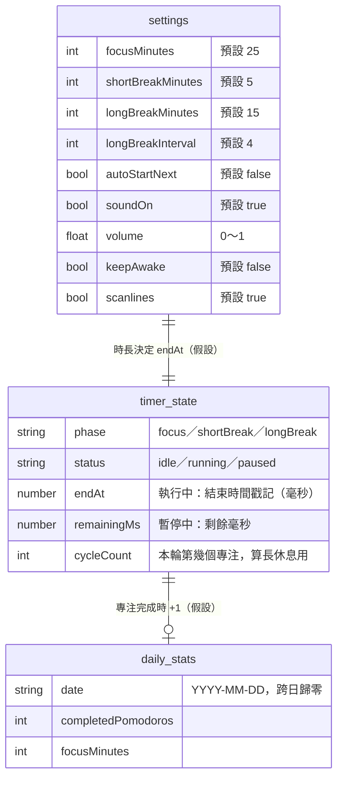
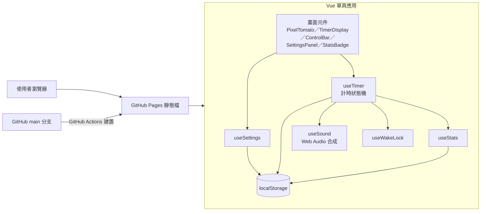

狀態：草案

# 像素蕃茄鐘

來源：口述，2026-10-23
相關規格：docs/規格/蕃茄鐘.md（尚未建立，第一版上線時建立）

## 需求原文重點

- Web 版蕃茄鐘，用 GitHub Pages 公開給大家使用，完全靜態、不用資料庫。
- 像素風格 UI；一般蕃茄鐘功能；可以有酷炫效果但不要太過火。
- 目標裝置：iPhone 13 mini 到 6.7 吋大手機，也要顧到摺疊機。
- 程式放在 https://github.com/BillWang99/Tomato_Clock.git

## 1. 第一版要做的

主流程：打開網頁 → 按開始 → 專注 25 分鐘 → 時間到提示 → 自動切到休息 → 循環。

- [ ] 計時核心：專注 25／短休息 5／長休息 15 分鐘，每 4 個專注後接長休息
- [ ] 操作：開始、暫停、繼續、重設本段、跳過本段；上方三個分頁可手動切換模式
- [ ] 計時以「結束時間戳記」計算，不靠 setInterval 累加：切到背景、鎖螢幕再回來時間仍然正確
- [ ] 重新整理頁面後恢復進行中的計時（存 localStorage）
- [ ] 時間到：8-bit 提示音（Web Audio 即時合成，不放音檔）＋畫面閃爍＋分頁標題顯示「⏰ 時間到」
- [ ] 分頁標題顯示倒數（例如 `12:34 專注中`），切到別的分頁也看得到
- [ ] 設定面板：三種時長、長休息間隔、時間到自動開始下一段、音效開關、音量、螢幕常亮
- [ ] 螢幕常亮：使用 Screen Wake Lock API，計時中不讓手機自動鎖定（不支援的瀏覽器隱藏此選項）
- [ ] 今日統計：今天完成幾顆蕃茄、累積專注分鐘（跨日自動歸零）
- [ ] 像素風格畫面：
  - 像素字型（中文用開源像素字型並只保留用到的字，控制檔案大小）
  - 像素蕃茄主角：專注時隨進度從綠轉紅，休息時換成休息造型
  - 方塊式進度條、像素邊框按鈕（按下有位移的立體感）
  - 專注／休息用不同主色（專注紅、短休息綠、長休息藍）
- [ ] 效果（適量）：
  - 完成一顆蕃茄時像素碎片爆開＋蕃茄跳一下
  - 背景極淡的 CRT 掃描線（可在設定關閉）
  - 使用者開啟「減少動態效果」時，所有動畫改為無或淡入淡出
- [ ] 版面支援：
  - 窄螢幕（寬 < 360）：摺疊機外螢幕，精簡版面
  - 一般手機（360～599）：iPhone 13 mini 375 到 6.7 吋 430，單欄
  - 寬螢幕（≥ 600）：摺疊機展開、平板、電腦，左邊計時、右邊設定與統計兩欄並排，中間留空避開摺痕
  - 橫向：計時與按鈕左右並排
  - 瀏海、動態島、底部橫條用 safe-area 留白；高度用 dvh，避免 Safari 網址列遮住按鈕
  - 按鈕至少 44×44 點，單手拇指可及的位置放主要按鈕
- [ ] 可加到主畫面：manifest 與像素圖示，從主畫面開啟時是全螢幕
- [ ] GitHub Actions 自動建置並發佈到 GitHub Pages

## 2. 之後再做的

- 離線使用（Service Worker 快取，PWA）
- 系統通知：鎖螢幕時也能提醒（iOS 只有加到主畫面的 PWA 才支援，見問題 3）
- 英文介面與語言切換
- 任務清單：每顆蕃茄綁定一件事
- 歷史統計：一週／一個月的長條圖
- 多種音效、白噪音背景音
- 主題切換（Game Boy 綠、紅白機配色、深色模式）
- 摺疊機的 Viewport Segments API（精準偵測摺痕位置；目前瀏覽器支援度低，第一版先用兩欄版面避開中間）

## 3. AI 自己假設的部分

| # | 假設 | 如果不對，影響什麼 |
|---|---|---|
| 1 | 技術：Vite + Vue 3 + TypeScript，用 composable 管理狀態，不用 Pinia | 換框架要重做；加 Pinia 只是結構調整 |
| 2 | 預設時長 25／5／15，每 4 個專注接長休息（經典蕃茄鐘） | 只是預設值，使用者可在設定改 |
| 3 | 介面語言先只做繁體中文 | 要雙語的話字型與文案都要多一份 |
| 4 | 所有資料只存在使用者自己的瀏覽器（localStorage），換手機或清除資料就沒了，不做帳號同步 | 要同步就需要後端，違反「完全靜態」 |
| 5 | 網址是 https://billwang99.github.io/Tomato_Clock/ ，Vite 的 base 設成 `/Tomato_Clock/` | 用自訂網域的話 base 改成 `/` |
| 6 | 目標瀏覽器：iOS Safari 16.4 以上、Android Chrome 最新兩版、電腦版 Chrome／Safari／Edge 最新版 | 要支援更舊的 iOS，螢幕常亮與部分 CSS 要退回 |
| 7 | 裝置尺寸以 CSS 寬度估計：iPhone 13 mini 約 375、6.7 吋約 430、摺疊機外螢幕約 344、展開約 670～880；最窄保證 320 | 有特定機型要測，請告知型號 |
| 8 | 像素字型用開源授權（SIL OFL）的中文像素字型，例如 Fusion Pixel Font，打包時只保留介面用到的字 | 字型授權不允許的話要換字型 |
| 9 | 「不要太過火」= 動畫只出現在狀態改變時（開始、完成、切換），計時中畫面保持安靜，只有進度在動 | 想要更熱鬧可再加 |
| 10 | 程式授權用 MIT，公開在 GitHub | 不想開源授權的話改成保留所有權利 |

## 4. 必須回答的問題（最多 3 個）

1. GitHub Pages 用哪種方式發佈？
   - 建議：GitHub Actions 建置後發佈，因為不用把建置產物提交進版控，推上 main 就自動更新。需要你到 repo 的 Settings → Pages，把 Source 設成「GitHub Actions」（這是遠端設定，我不能代你改）。
   - 其他選項：建置後推到 `gh-pages` 分支，Source 設成該分支。
2. 介面語言要只有繁體中文，還是中英雙語？
   - 建議：第一版只做繁體中文，因為中文像素字型只保留用到的字，檔案小；英文之後再加。
   - 其他選項：第一版就中英雙語，跟著瀏覽器語言切換。
3. 手機鎖螢幕或切到別的 App 時，網頁無法在時間到的那一刻發出聲音（iOS 會暫停背景網頁），這個限制第一版可以接受嗎？
   - 建議：接受。第一版提供「螢幕常亮」讓計時中手機不自動鎖定，回到網頁時立刻顯示「時間到」並補播提示音；鎖屏通知放到之後的 PWA 版本。
   - 其他選項：第一版就做 PWA 通知，但 iOS 使用者必須先「加到主畫面」才能收到，且需要額外的推播服務，不再是純靜態。

## 5. 審查包

### 資料結構

沒有資料庫。以下是存在使用者瀏覽器 localStorage 的三個 key，前綴 `tomato:`。全部是 AI 的假設。

### 系統架構

為什麼這樣切：計時正確性是這個專案唯一的「高風險」，所以把它集中在 `useTimer` 一個狀態機裡，只依賴「現在時間」與「結束時間戳記」，不碰畫面，可以用假時鐘做單元測試（背景、暫停、跨日、重新整理都能測）。畫面元件只負責顯示與發出操作，像素風格與動畫的改動不會影響計時邏輯。聲音、螢幕常亮這類瀏覽器能力各自包成 composable，不支援時可以單獨關掉。

### 介面

沒有後端 API，也沒有 MCP 工具。對外只有一個靜態頁面。

| 方法 | 路徑或工具名稱 | 用途 | 權限 |
|---|---|---|---|
| GET | /Tomato_Clock/ | 蕃茄鐘單頁應用 | 公開，不需登入 |
| GET | /Tomato_Clock/manifest.webmanifest | 加到主畫面用的設定 | 公開 |
