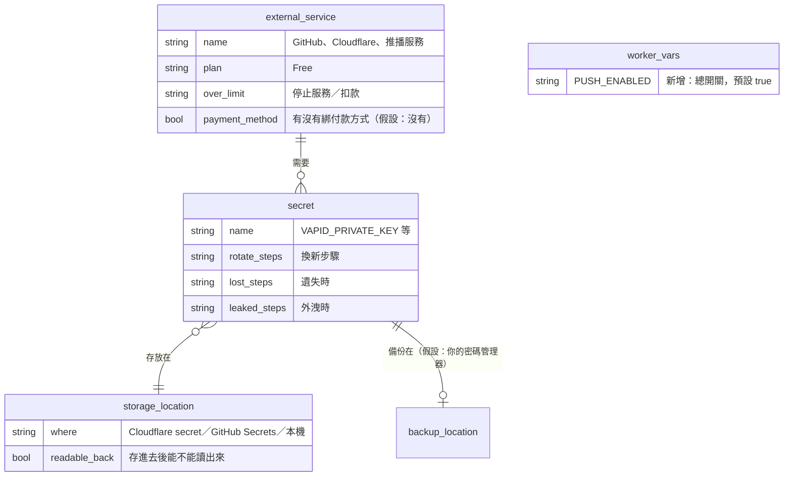
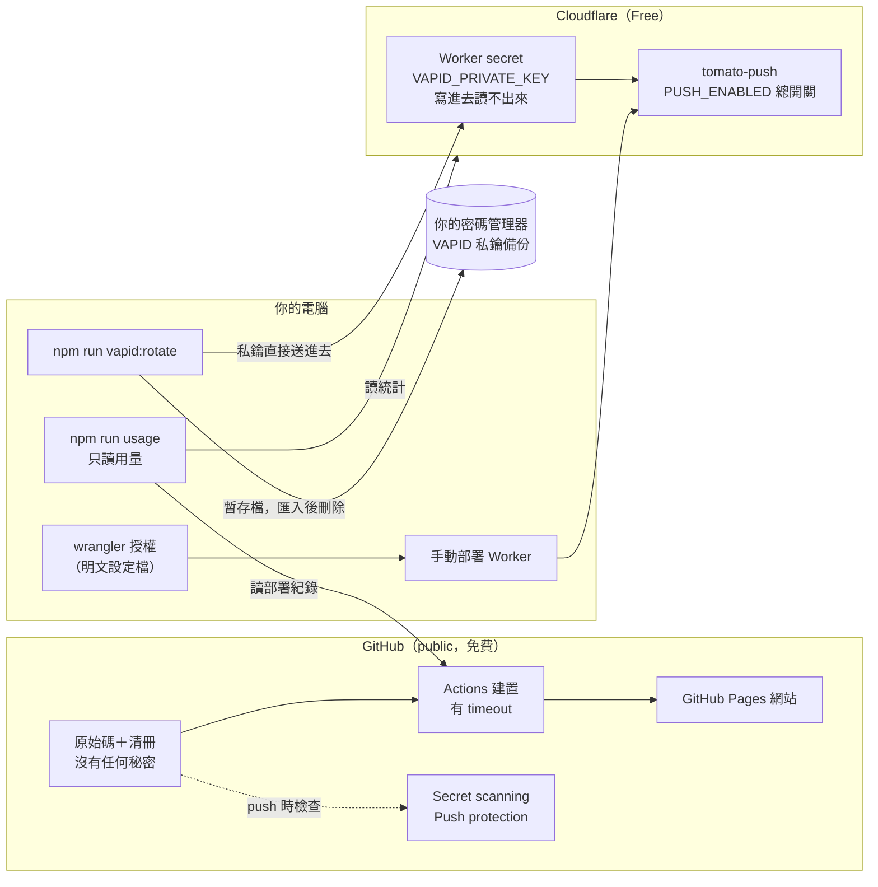

狀態：已定案

# 金鑰與外部服務管理

來源：口述，2026-10-24（「幫我設計金鑰或是外部服務的管理機制，避免造成額外費用，我秉持 0 成本精神」）
相關規格：docs/規格/蕃茄鐘.md（「鎖螢幕推播」「發佈」）；第一版上線時新開領域 docs/規格/外部服務與金鑰.md

## 目標

1. **0 成本**：每個外部服務都停在免費方案，而且「超過額度 = 停止服務」，不會變成「超過額度 = 扣款」。
2. **秘密不進 Git**：不管 repo 是 public 還是 private，秘密一律放在服務商的秘密欄位或你的密碼管理器，repo 只放「清冊」（放在哪、怎麼換），不放值。
3. **壞了救得回來**：每把金鑰都有「遺失／外洩時怎麼辦」的步驟，照著做 10 分鐘內恢復。

## 現況盤點（2026-10-24）

| 外部服務 | 用途 | 方案 | 超過額度會怎樣 | 綁付款方式 |
|---|---|---|---|---|
| GitHub（public repo） | 原始碼、Pages 網站、Actions 部署 | Free | public repo 的 Actions 與 Pages 不計費 | 否（假設） |
| Cloudflare Workers＋Durable Objects | 推播伺服器 tomato-push | Free | 當天停止服務，不扣款 | 否（假設） |
| Apple／Google／Mozilla 推播服務 | 把通知送到手機 | 免費，不需帳號 | — | — |
| npm registry、Fusion Pixel Font（GitHub release） | 套件、字型下載 | 免費 | — | — |

| 秘密 | 用途 | 現在放哪 | 備份 | 問題 |
|---|---|---|---|---|
| VAPID 私鑰 `VAPID_PRIVATE_KEY` | 推播簽章 | Cloudflare Worker secret（寫進去就讀不出來） | **沒有** | Worker 被刪或換帳號時只能換新金鑰，現有使用者要重開推播 |
| Cloudflare 登入授權（wrangler OAuth） | 從你的電腦部署 Worker | `~/Library/Preferences/.wrangler/config/default.toml` | 不需要（隨時可重新登入） | 權限很大（30 項），存在明文檔案 |
| GitHub 登入 | push 程式碼 | 你電腦的 git 認證 | 不需要 | — |

公開設定（不是秘密，放 repo 沒問題）：VAPID 公鑰、Worker 網址、允許來源 `ALLOWED_ORIGINS`、`VAPID_SUBJECT`。

## 1. 第一版要做的

- [ ] **清冊文件** `docs/規格/外部服務與金鑰.md`：上面兩張表的正式版，加上每把金鑰的「換新」「遺失」「外洩」三種處理步驟，以及「0 成本守則」
- [ ] **用量檢查** `npm run usage`：一個指令列出
  - Cloudflare 今天的 Worker 請求、Durable Object 請求、錯誤數，與免費額度（每天 10 萬次）的百分比；超過 50% 顯示提醒、超過 80% 顯示警告
  - GitHub Actions 本月的部署次數與總分鐘數（public repo 免費，但如果哪天改成 private，就看得出會不會超過每月 2000 分鐘）
  - 提醒你到 Cloudflare 後台確認「方案是 Free、沒有綁付款方式」（Cloudflare 的帳單 API 需要另外的權限，第一版不自動查）
- [ ] **金鑰換新腳本** `npm run vapid:rotate`（在 push-worker）：產生新金鑰 → 私鑰直接送進 Cloudflare（不顯示在畫面）→ 同時把私鑰存成一個只有你能讀的檔案，讓你匯入密碼管理器後刪掉 → 自動更新 `wrangler.jsonc` 與 `src/core/pushConfig.ts` 的公鑰
- [ ] **防爆措施**
  - GitHub Actions 每個步驟加上 `timeout-minutes`（例如建置 10 分鐘、發佈 5 分鐘），卡住的部署不會一直吃分鐘數
  - 推播伺服器加「總開關」變數 `PUSH_ENABLED`：設成 `false` 時伺服器直接回「暫停服務」、不碰 Durable Object，遇到被灌請求時一行指令就能止血，網站照常可用
  - `.gitignore` 補上常見的秘密檔名（`.env*`、`*.pem`、`*.key`、`.dev.vars*`，但保留 `*.example`）
  - `push-worker/.dev.vars.example`：本機開發要用的秘密欄位名稱範本（沒有值）
- [ ] **你要在網頁後台做的設定清單**（放進清冊，每項都是免費功能）：GitHub 開啟 Secret scanning 與 Push protection（擋下不小心 push 的金鑰）；Cloudflare 確認沒有付款方式、Wrangler 授權只保留需要的
- [ ] bstack 的上線後檢查（`bstack verify-release`）順便跑 `npm run usage`

## 2. 之後再做的

- 推播伺服器改由 GitHub Actions 自動部署（需要一個只能改 tomato-push 的 Cloudflare API Token 放在 GitHub Secrets）
- 每月自動寄一次用量報告（排程任務）
- Dependabot 自動更新套件（免費，但會多很多 PR）
- 改用權限較小的 Cloudflare API Token 取代 wrangler 的完整 OAuth 授權

## 3. AI 自己假設的部分

| # | 假設 | 如果不對，影響什麼 |
|---|---|---|
| 1 | 你的 Cloudflare 與 GitHub 帳號都**沒有綁付款方式**；沒綁就不可能被收費 | 有綁的話，清冊要多一步「移除付款方式」或「設定帳單上限」 |
| 2 | repo 維持 public：GitHub Pages、Actions、Secret scanning 都免費；改 private 需要 GitHub Pro（約每月 4 美元）或把網站搬到 Cloudflare Pages | 堅持 private 的話要另開「搬家計劃」 |
| 3 | 金鑰備份放在你自己的密碼管理器（1Password、Bitwarden、iCloud 鑰匙圈都可以），不放任何雲端硬碟或 repo | 你沒有密碼管理器的話，改成存在加密的 USB／離線筆記 |
| 4 | 用量檢查用你電腦上已經登入的 wrangler 授權去讀 Cloudflare 統計（只讀），不另外申請金鑰 | 之後改成自動化（GitHub Actions）時才需要另外的 API Token |
| 5 | 提醒門檻：免費額度用到 50% 提醒、80% 警告；以目前用量（每天十幾次）幾乎不會觸發 | 想更早知道可以調低 |
| 6 | 「總開關」關掉時，App 那邊只會在設定裡顯示「推播伺服器出錯」，計時與畫面上的提醒不受影響（現有的錯誤處理就做得到） | 想顯示「維護中」之類的專屬文字要另外改前端 |
| 7 | 不加任何付費或需要另外註冊的監控服務（例如 UptimeRobot、Sentry），維持 0 個新外部服務 | — |

## 4. 必須回答的問題（最多 3 個）

2026-10-24 使用者回覆：三題都採用建議。

- 答 1：換一組 VAPID 金鑰，私鑰備份到使用者的密碼管理器。
- 答 2：推播伺服器繼續從使用者的電腦手動部署。
- 答 3：repo 維持 public。

1. **推播私鑰現在沒有任何備份，要不要趁現在換一組並備份起來？**
   - 建議：**換**。現在只有你自己在用推播，換金鑰的代價只是你在 App 設定裡把「鎖螢幕也提醒」關掉再打開一次；之後使用者變多再換，每個人都要重開。換的時候私鑰會存成一個只有你能讀的檔案，你匯入密碼管理器後刪掉。
   - 其他選項：不換、不備份；哪天 Worker 被刪才換（到時候所有使用者都要重開推播）。
2. **推播伺服器要繼續從你的電腦手動部署，還是改成 GitHub 自動部署？**
   - 建議：**繼續手動**。伺服器很少改，手動部署就不用把任何 Cloudflare 金鑰放進 GitHub，秘密少一個、風險少一個。
   - 其他選項：改成自動部署（要在 Cloudflare 建一個只限 tomato-push 的 API Token 放進 GitHub Secrets；放到「之後再做」）。
3. **repo 維持 public 嗎？**
   - 建議：**維持 public**。照這份計劃，repo 裡不會有任何秘密，public 讓 Pages、Actions、秘密掃描都免費。
   - 其他選項：改 private＋升級 GitHub Pro（每月約 4 美元，違反 0 成本）；或改 private＋網站搬到 Cloudflare Pages（免費，但網址會變、已安裝的 App 要重裝、推播的允許來源要改）。

## 5. 審查包

> **安全注意**：
> - 這份計劃處理的是**秘密本身**：VAPID 私鑰在換新時會短暫存成本機檔案（權限只有你能讀），請匯入密碼管理器後立刻刪除；腳本不會把私鑰印在畫面或對話裡。
> - wrangler 的 Cloudflare 授權權限很大，而且以明文存在你電腦上；電腦遺失時要到 Cloudflare 後台撤銷（My Profile → Access Management → Connected Applications）。清冊會寫明這一步。
> - 「總開關」是降低損害用的，不是防護本身；真正的防護仍是既有的網址白名單、固定文字與頻率限制。

### 資料結構

沒有資料庫。這裡的「資料」是清冊文件裡的兩張表，以及 Worker 多一個設定變數。全部是 AI 的假設。

| 動作 | 對象 | 等級 | 說明 |
|---|---|---|---|
| 新增 | Worker 變數 `PUSH_ENABLED` | 綠 | 預設 `true`，現有行為不變 |
| 修改 | Worker secret `VAPID_PRIVATE_KEY`（若問題 1 選「換」） | 黃 | 換新後舊的推播訂閱全部失效，使用者要重開推播（目前只有你） |

### 系統架構

為什麼這樣切：秘密只有兩種去處，「服務商的秘密欄位」（給程式用，存進去讀不出來）和「你的密碼管理器」（給人備份用），repo 永遠只放清冊不放值，所以 public 或 private 都不影響安全。成本靠兩件事保證：每個服務都在「超量就停」的免費方案、而且帳號沒有付款方式；用量檢查只是讓你提早看到數字，不是靠它擋。所有新東西都是本機腳本與文件，**不新增任何外部服務**。

### 介面

沒有新的公開 API。新增的是本機指令與伺服器的一個行為：

| 方法 | 路徑或工具名稱 | 用途 | 權限 |
|---|---|---|---|
| 指令 | `npm run usage` | 列出 Cloudflare 今日用量與 GitHub Actions 本月用量，對照免費額度 | 你電腦上已登入的 wrangler（只讀） |
| 指令 | `npm run vapid:rotate`（push-worker） | 換新 VAPID 金鑰：私鑰送進 Cloudflare＋存成暫存備份檔，公鑰更新到設定 | 你電腦上已登入的 wrangler |
| 指令 | 改 `wrangler.jsonc` 的 `PUSH_ENABLED` 再 `npx wrangler deploy` | 總開關：`false` 時暫停推播服務（不能用 `wrangler secret put`：已有同名變數） | 同上 |
| POST | `/api/schedule`、`/api/cancel`（既有） | `PUSH_ENABLED=false` 時回 503「推播暫停服務」，不建立 Durable Object | 公開（既有限制不變） |
