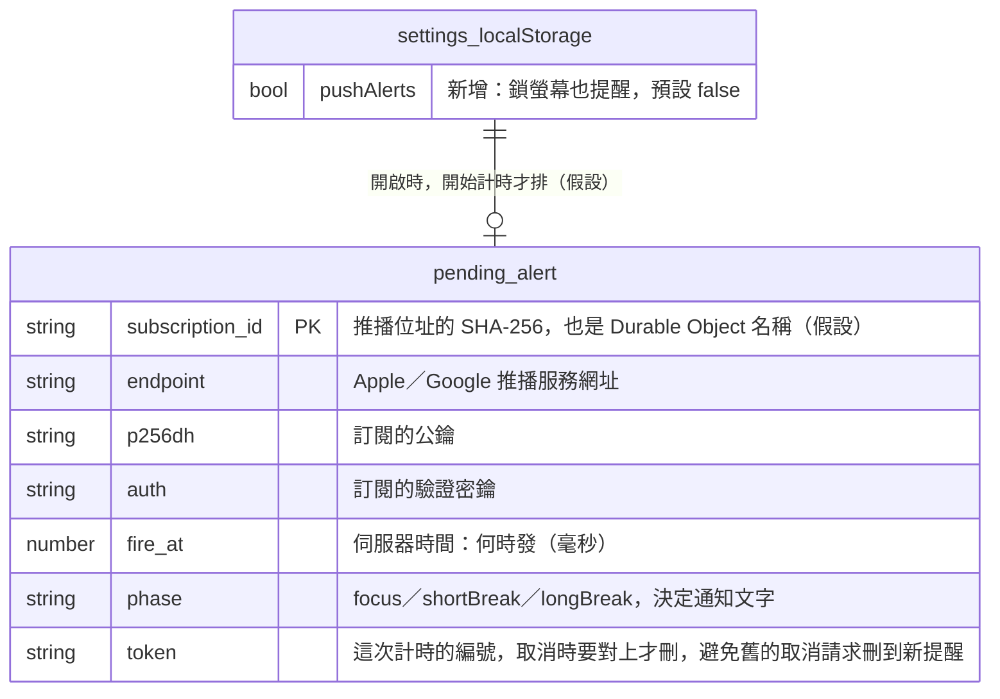
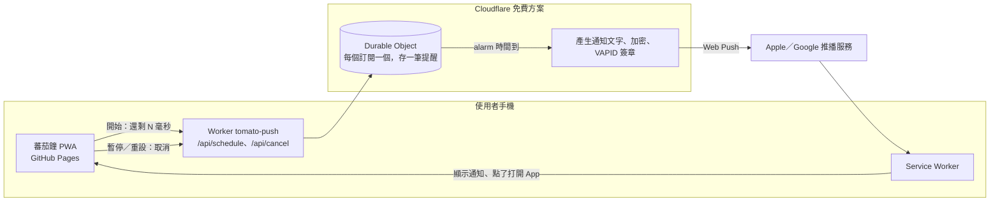

狀態：已定案

# 鎖屏推播提醒

來源：口述，2026-10-23～24（使用者在 iOS 加到主畫面後，鎖螢幕時沒有提示）
相關規格：docs/規格/蕃茄鐘.md（「時間到的提示」已知限制、「PWA」）

## 為什麼要伺服器

iOS 不讓網頁（含加到主畫面的 App）在背景執行，也沒有「預約本機通知」的功能，所以手機鎖住後，網頁自己沒辦法在時間到的那一刻出聲。唯一能叫醒手機的是**推播（Web Push）**：由伺服器在時間到時送一則推播給 Apple／Google 的推播服務，系統再顯示通知。這代表要在「完全靜態」之外加一個很小的伺服器，只做一件事：**記住「幾點要提醒誰」，時間到就發推播**。

## 1. 第一版要做的

主流程：在設定開啟「鎖螢幕也提醒」→ 允許通知 → 按開始 → 鎖手機 → 時間到，鎖定畫面跳出「專注完成！休息一下吧」並響系統提示音 → 點通知回到 App。

- [ ] Cloudflare Worker `tomato-push`（新的資料夾 `push-worker/`，與網站分開部署）
  - [ ] `POST /api/schedule`：收到推播訂閱與「幾毫秒後提醒」，排一個提醒（每個訂閱只保留最新一筆，新的取代舊的）
  - [ ] `POST /api/cancel`：取消提醒（暫停、重設、跳過、切換模式、App 開著時自己先發現時間到）
  - [ ] 每個訂閱一個 Durable Object，用它的 alarm 在時間到時醒來發推播，發完立刻刪資料
  - [ ] 推播內容由伺服器依階段產生固定文字，不接受前端傳任意文字（避免被拿來發廣告）
  - [ ] 只接受 1 秒～100 分鐘的提醒；只允許網站的網址呼叫（CORS）；同一個 IP 每分鐘最多 30 次
- [ ] 網站端
  - [ ] 設定新增開關「鎖螢幕也提醒（推播）」，預設關閉；瀏覽器不支援推播時不顯示；iPhone 在 Safari 分頁裡打開時改成顯示「先加到主畫面才能用」
  - [ ] 打開開關時才跳出通知權限（iOS 規定要使用者點擊才能問）
  - [ ] 開始／繼續時排提醒，暫停／重設／跳過／切換模式時取消；改用「還剩幾毫秒」傳給伺服器，不用手機時間，避免手機時鐘不準
  - [ ] Service Worker 加上收到推播時顯示通知、點通知時打開 App
  - [ ] 網路斷掉或伺服器沒回應時不影響計時，只是這次沒有推播，設定面板顯示一行小字說明
- [ ] 文件：規格「時間到的提示」「PWA」「存在瀏覽器的資料」更新；新增隱私說明；上線紀錄記下 Worker 的部署
- [ ] 測試：Worker 的排程、取消、時間範圍、舊提醒被新提醒取代（用 Cloudflare 的本機測試環境）；網站端開始／暫停時有呼叫排程與取消

## 2. 之後再做的

- 「自動開始下一段」時，鎖著手機也能接連提醒下一段（伺服器要知道整輪的時長，第一版只提醒目前這一段）
- 自訂通知文字、勿擾時段
- Worker 用自訂網域（例如 push.你的網域），第一版用免費的 `*.workers.dev`
- Worker 的自動部署（GitHub Actions），第一版先手動部署
- 通知上的「開始休息」按鈕（iOS 目前不支援通知按鈕）

## 3. AI 自己假設的部分

| # | 假設 | 如果不對，影響什麼 |
|---|---|---|
| 1 | 用 Cloudflare Workers 免費方案＋Durable Objects（SQLite 版，免費方案可用）；Worker 網址是 `https://tomato-push.<你的子網域>.workers.dev` | 換平台要重寫排程部分 |
| 2 | 費用：免費方案每天 10 萬次 Worker 請求、10 萬次 Durable Object 請求（含 alarm 醒來），一次計時約用 2～3 次，約可撐每天 3 萬次計時，**個人與小規模公開使用是 0 元**；超過時當天的推播會失敗（不會自動扣款），計時本身不受影響 | 使用量大到需要升級時，付費方案每月 5 美元起 |
| 3 | Web Push 不需要 Apple 開發者帳號，也不收費；iOS 需要 16.4 以上且從主畫面打開 App 才能訂閱 | — |
| 4 | 通知聲音用系統預設的提示音，網頁沒辦法指定 8-bit 音效；手機開靜音或專注模式時照系統規則不響 | 一定要 8-bit 聲音的話做不到 |
| 5 | App 開著時時間到，通知也可能同時跳出一次（iOS 規定每則推播都要顯示，不能偷偷收掉）；App 會在自己發現時間到時先取消提醒，大部分情況不會重複 | 介意的話要接受偶爾重複 |
| 6 | 推播加密用瀏覽器標準的 Web Crypto 在 Worker 裡做（RFC 8291），用一個小型、無相依的套件，不用 Node 的 web-push | 若套件不相容要自己實作加密，多 1～2 天 |
| 7 | VAPID 的聯絡資訊（subject）填 repo 網址 `https://github.com/BillWang99/Tomato_Clock`，不用你的 Email | Apple 不接受時改用 `mailto:` |
| 8 | 有網友回報 iOS 的推播訂閱放久了可能失效；App 每次打開時會檢查訂閱，失效就自動重新訂閱 | 長時間沒打開 App 後的第一次提醒可能收不到 |
| 9 | 隱私：伺服器只暫存「推播位址＋加密金鑰＋提醒時間＋階段」，不存姓名、Email、IP；提醒發出或取消後立刻刪除；Worker 關閉請求日誌 | 要存使用紀錄做統計的話需要另外的隱私告知 |

## 4. 必須回答的問題（最多 3 個）

2026-10-24 使用者回覆：三題都採用建議。

- 答 1：使用者自己註冊 Cloudflare 帳號並執行 `npx wrangler login`；程式由 AI 寫，每次部署前先問。
- 答 2：預設關閉，任何支援推播的瀏覽器都能在設定打開。
- 答 3：維持免費方案，超過當天額度就不發推播。

1. Cloudflare 帳號由誰建立、誰登入部署？
   - 建議：你自己註冊免費的 Cloudflare 帳號（不需要信用卡），在終端機跑一次 `npx wrangler login`（會開瀏覽器授權）。程式由我寫，每次部署 Worker 前我會先問你，因為部署是遠端操作。
   - 其他選項：你把帳號與部署全部自己來，我只提供程式和指令。
2. 推播要給誰用？
   - 建議：預設關閉，任何支援推播的瀏覽器都能在設定打開（iPhone 主畫面 App、Android Chrome、電腦版瀏覽器），因為程式完全一樣，只是 iPhone 多一個「要先加到主畫面」的限制。
   - 其他選項：只在 iPhone 主畫面 App 顯示這個開關。
3. 免費額度用完時怎麼辦？
   - 建議：維持免費方案，超過當天額度就不發推播（App 照常計時、回到 App 時照常提醒），不會有任何費用；用量真的變大再討論升級。
   - 其他選項：直接升級付費方案（每月 5 美元），不怕用量突增。

## 5. 審查包

> **安全注意**：
> - **新增一個不用登入的公開 API**（`/api/schedule`、`/api/cancel`）。任何人都能呼叫，所以伺服器只對「呼叫者自己提供的推播訂閱」發推播、內容是固定文字、時間限制在 100 分鐘內、限制來源網址與每個 IP 的頻率，避免被拿來亂發通知或灌爆免費額度。
> - **推播訂閱算是裝置識別資料**（一串 Apple／Google 的網址加金鑰）。只在提醒排定期間暫存在 Cloudflare，發完或取消就刪；設定面板與規格要寫隱私說明。
> - **VAPID 私鑰**是秘密，只存在 Cloudflare 的 Worker secret，不進 Git、不放前端；公鑰可以公開放在網站設定裡。

### 資料結構

沒有傳統資料庫。伺服器端是「每個推播訂閱一個 Durable Object」，裡面最多一筆待發提醒；網站端只在設定多一個開關。全部是 AI 的假設。

| 動作 | 對象 | 等級 | 說明 |
|---|---|---|---|
| 新增 | `tomato:settings.pushAlerts` | 綠 | 新欄位，舊資料讀不到就是 false，不影響現有使用者 |
| 新增 | Worker 的 `pending_alert` | 綠 | 全新的儲存，跟網站資料無關 |

### 系統架構

為什麼這樣切：網站維持在 GitHub Pages、繼續是靜態檔，計時邏輯完全不變，推播只是「多一個提醒管道」，伺服器掛掉也不影響計時。伺服器只負責「定時」這件網頁做不到的事，用 Durable Object 的 alarm 而不是每分鐘掃一次的排程：每個提醒精準在那一刻醒來，而且一個訂閱只有一筆資料，新的自然取代舊的、發完就刪，沒有要清理的資料表。推播加密與簽章都在 Worker 裡用 Web Crypto 做，不需要額外的服務。

### 介面

| 方法 | 路徑或工具名稱 | 用途 | 權限 |
|---|---|---|---|
| POST | `/api/schedule` | 排一個提醒：`{ subscription, delayMs, phase, token }`，delayMs 限 1 秒～100 分鐘 | 公開；只接受網站網址來源（CORS）；每 IP 每分鐘 30 次 |
| POST | `/api/cancel` | 取消提醒：`{ endpoint, token }`，token 對上才刪 | 同上 |
| GET | `/api/health` | 給 `verify-deploy` 檢查 Worker 是否活著 | 公開 |
| （內部） | Durable Object alarm | 時間到發推播並刪資料 | 只有 Worker 自己 |
| （瀏覽器） | Service Worker `push`／`notificationclick` 事件 | 顯示通知、點通知打開 App | — |

### 你需要自己做的設定

1. 到 https://dash.cloudflare.com/sign-up 註冊免費帳號（Email＋密碼，不用信用卡）。
2. 在專案資料夾跑 `npx wrangler login`，瀏覽器會跳出 Cloudflare 授權頁，按允許。
3. 第一次部署時，Cloudflare 會請你選一個 `workers.dev` 子網域（例如 `billwang99`），之後 Worker 網址就是 `https://tomato-push.billwang99.workers.dev`。
4. 我會用腳本在本機產生一組 VAPID 金鑰：公鑰寫進網站設定（可以公開）；私鑰請你用 `npx wrangler secret put VAPID_PRIVATE_KEY` 貼進 Cloudflare（不會進 Git）。
5. 部署 Worker（`npx wrangler deploy`）與部署網站都是遠端操作，每次我都會先問你。
6. 上線後在 iPhone：從主畫面打開 App → 設定打開「鎖螢幕也提醒」→ 允許通知 → 開始一個 1 分鐘的計時、鎖手機，確認有收到通知。
